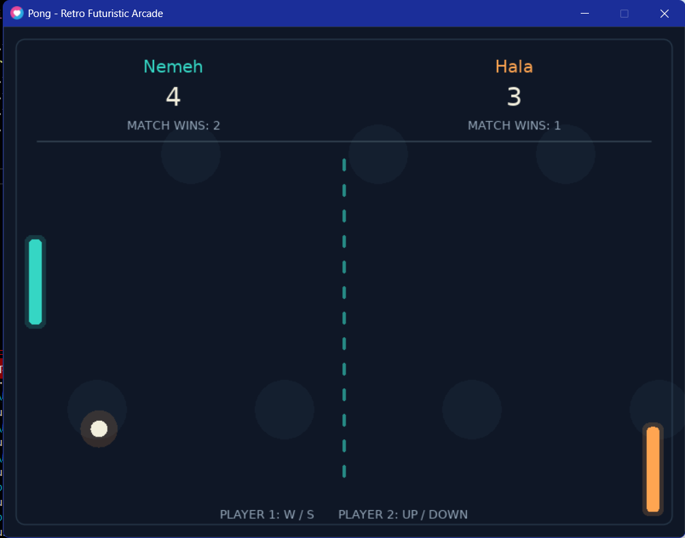

# Pong Game – LÖVE2D

**Student Name:** Nemeh K. Abu Issa  

## Game Description

This project is a two-player Pong game developed using Lua and the LÖVE2D framework. Each player controls a paddle to hit the ball and prevent it from passing their side of the screen. The game includes paddle movement, ball physics, wall and paddle collision detection, and a scoring system. The first player to reach 5 points wins the match. Additionally, the game features custom player names, a retro-futuristic visual design, and several gameplay enhancements to improve the overall gaming experience.

## How to Run

### Prerequisites

- Install [LÖVE 11.5](https://love2d.org/) on your computer.
- Make sure the LÖVE executable is available in your system PATH.

### Running the Game

1. Clone or download this repository.
2. Open a terminal or PowerShell.
3. Navigate to the project folder (the folder containing `main.lua`).
4. Run the following command:

```bash
love .
```

The game window will open and you can start playing!

**Windows Alternative:**

If the `love` command is not recognized, you can run the game using the full path to your local LÖVE executable:

```powershell
& "PATH_TO_LOVE\love.exe" .
```

Replace `PATH_TO_LOVE` with the location where LÖVE is installed on your computer.

## Controls

| Key | Action |
|---|---|
| W | Move Player 1 paddle up |
| S | Move Player 1 paddle down |
| Up Arrow | Move Player 2 paddle up |
| Down Arrow | Move Player 2 paddle down |
| Enter | Start a new match / Play again |
| N | Change player names after a match |

## Own Changes & Extra Features

- **Different Paddle Colors:** Each player's paddle has a distinct color.
- **Dynamic Ball Speed:** The ball speed increases by 5% after every paddle collision, up to a maximum speed.
- **Custom Player Names:** Players can enter their names before starting a match.
- **Winning System:** The first player to reach 5 points wins the match.
- **Match Wins Counter:** Tracks match wins during the current game session.
- **Replay System:** Players can start a new match while keeping their match win records.
- **Player Name Customization:** Players can enter new names after a match ends.
- **Custom Game Design:** A retro-futuristic visual theme.

## Screenshot



## Demo Video

[Watch the Pong Game Demo](https://drive.google.com/file/d/1367vqwxo1Vx2zlCo2OjdmPdChs5zbBq8/view?usp=sharing)
